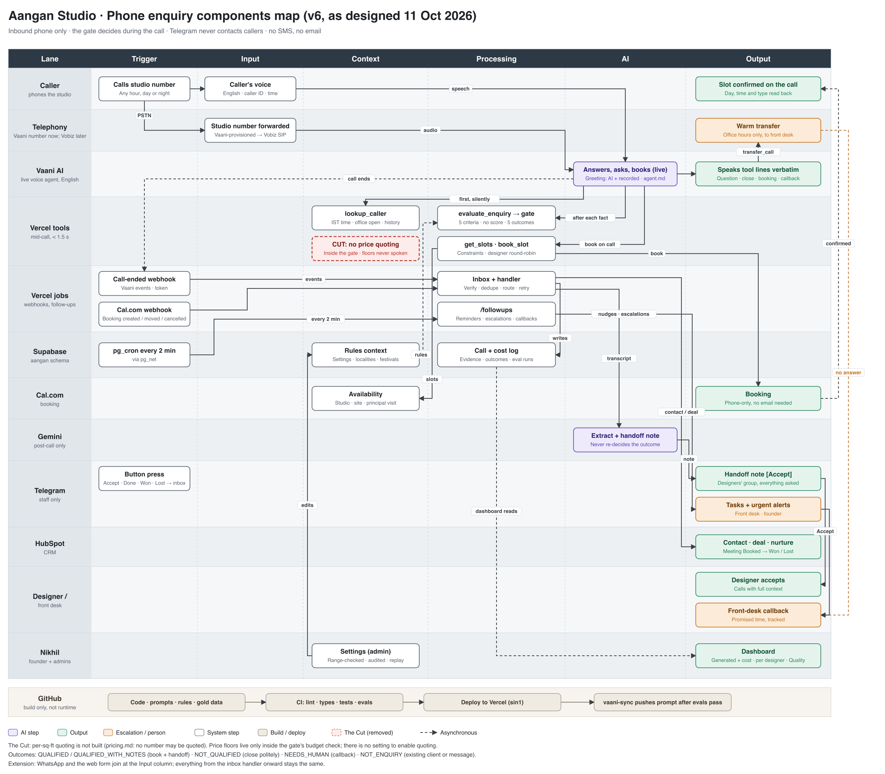

# Aangan Frontdesk

An AI front desk for **Aangan Studio**, a 60-person interior design studio in Pune. It answers every inbound phone call, day or night, checks the caller against the founder's own five rules, books a consultation on the call, hands qualified leads to a designer with everything already asked, and shows the founder what the system costs and what it generates.

> **Status:** built and deployed; not yet taking real calls. The voice agent, tools, gate, booking, handoff pipeline, follow-ups, dashboard and settings are live. Connecting a phone number and a pilot week come next (see [Still open](#still-open)).
>
> **Live:** https://aangan-frontdesk.vercel.app

Built for MESA Case 03 ("Nikhil: Unanswered Enquiries").

---

## The problem

| Fact | Source |
|---|---|
| ~200 enquiries a month across phone, WhatsApp and a web form | Case brief |
| ~48% get no response within 48 hours | Case brief |
| ~33% arrive outside 10am to 7pm, when the 2-person front desk is gone | Case brief |
| Answered within 1 hour converts at 4x the rate of next-day | Case brief |
| Designers get forwarded messages with no context and re-ask everything | Case brief |
| Average project value ₹8 to 14 lakh | Case brief |

**The founder's ask:** "Every enquiry must get answered in five minutes, day or night. The ones worth my designers' time should reach them with everything already asked. And the system should be able to quote our standard per-square-foot pricing so people don't have to wait for that."

## Scope

- **In:** inbound **phone calls** only.
- **Out:** WhatsApp and the web form. They join later at the input layer; everything after the webhook stays the same.

## The Cut

Quoting per-square-foot pricing is **not built**. The studio's own pricing guide says: "No number from this guide should be quoted to a client." The agent gives only the approved line ("Pricing depends on the site, the materials you choose, and the scope...") and offers to book. Price floors are used only inside a server-side budget check and are never spoken. There is no setting to turn quoting on.

## Stack

| # | Tool | Job |
|---|---|---|
| 1 | Telephony | **Now:** Vaani direct-provisioned number. **Later:** Vobiz number over SIP. Swapping does not change the agent. |
| 2 | Vaani (vaanivoice.ai) | Live voice agent: talks, asks, calls our tools mid-call, books, transfers, calls back. One language per agent: **English (en-IN)**. |
| 3 | Gemini API | After the call only: extract fields and write the handoff note. Does not re-decide the outcome. |
| 4 | Vercel (Next.js, region `sin1`) | Mid-call tool endpoints, webhook handlers, follow-up endpoint, dashboard. |
| 5 | Supabase (hosted) | System of record in its own `aangan` schema; `pg_cron` drives follow-ups. |
| 6 | Cal.com | Booking during the call (studio consult, site visit, principal-designer visit). |
| 7 | Telegram Bot API | Designer handoff with Accept, front-desk tasks, urgent alerts. Never contacts callers. |
| 8 | HubSpot | Contacts, deals and nurture tasks. |
| 9 | GitHub | Code, prompts and rules, versioned; pushes to `main` deploy to Vercel. Not part of the runtime. |

No SMS and no email.

## How a call flows

```
Caller --> phone number --> Vaani live agent
                              |  greeting: AI disclosure + recording consent
                              |  lookup_caller(): history + today's date/time
                              |
                              +-- existing client / complaint --> urgent Telegram alert
                              +-- other (vendor, job, spam)    --> front-desk task
                              +-- new enquiry
                                     |
                                     v
                              service fit + five criteria (plain code, called mid-call)
                                     |
                                     v
                              GATE (no score)
                                QUALIFIED / QUALIFIED_WITH_NOTES --> book on the call
                                NOT_QUALIFIED                    --> close gracefully
                                NEEDS_HUMAN                      --> transfer or callback
                                     |
                              call ends --> webhook --> Supabase --> Gemini note
                                     |
                       +-------------+--------------+
                       v             v              v
               Telegram handoff   HubSpot       Founder dashboard
               (Accept button)    deal/task     (cost + value)

pg_cron every few minutes --> follow-ups: unaccepted handoffs, overdue callbacks, nudges
```

## Qualification gate

From the founder's rubric: a lead reaches a designer only if it passes all five criteria.

| # | Criterion | Unclear? |
|---|---|---|
| C1 | Real project: design and execution, not advice | Ask one direct question |
| C2 | Site in Pune city or PCMC | Ask one direct question |
| C3 | Workable timeline | Ask one direct question |
| C4 | Budget not clearly too low (only if the caller volunteers one; never asked) | Pass, note it |
| C5 | Decision-maker on the call or authorised | Pass, note it |

Any clear fail closes the call gracefully. Asking about price never disqualifies.

## Admin-editable settings (defaults)

| Setting | Default | Why |
|---|---|---|
| Designer accept: reminder / escalate | 15 / 30 min, office hours Mon to Fri 10:00 to 19:00 IST | Keeps the first designer contact inside the 1-hour window |
| Timeline hard fail | under 6 weeks | Services guide: "cannot begin... under 6 weeks" |
| Timeline flagged tight | 6 to 12 weeks | Design 3 to 4 weeks + execution 8+ weeks |
| Budget "clearly below" | under 50% of the price floor | Separates the rubric's own fail example from real leads |
| Commercial under 500 sq ft | send to a person, never auto-decline | Practised by the front desk but not written in the rules |
| Still unclear after one question | C1, C3: book with a note. C2: send to a person | "The designer establishes fit at the consultation" |

Every change is range-checked, needs a reason, and is kept in an audit log.

## Founder dashboard

- **Generated:** calls, after-hours share, time to answer, outcomes by gate result, most common failing criterion, booked to consulted to won, pipeline value, per-designer acceptance time.
- **Cost:** per-call (telephony minutes, Vaani minutes, Gemini tokens) and fixed monthly plans; cost per call, per qualified lead, per booking, per won project.

## Architecture



| Path | What |
|---|---|
| `src/lib/rules/` | The gate: parsers, office hours, wording, `evaluateEnquiry` (plain code, no model) |
| `src/lib/tools/`, `src/app/api/vaani/tools/` | Mid-call tools: `lookup_caller`, `evaluate_enquiry`, `log_intent` |
| `src/lib/booking/` | `get_slots`, `book_slot`, Cal.com webhook |
| `src/lib/pipeline/` | Vaani webhook events: link the call, safety flags, Gemini note, route by outcome |
| `src/lib/telegram/` | Staff messages and the Accept button |
| `src/lib/followups/`, `src/app/api/cron/followups/` | Reminders, escalations, callbacks, CRM sync, retention (every 2 min via `pg_cron`) |
| `src/lib/dashboard/`, `src/app/dashboard/` | Founder dashboard and admin settings |
| `src/evals/` | Eval runners, graders and the agent simulator |
| `prompts/` | Agent prompt and the note-writer prompt |
| `docs/` | Qualification rules, database, latency, privacy, agent prompt checklist |

## Setup

Needs Node 22+, the Vercel CLI and access to the Supabase project.

```bash
git clone https://github.com/SathishAchilles/aangan-frontdesk && cd aangan-frontdesk
npm install
cp .env.example .env.local      # fill in every value; see the comments in the file
npm run db:migrate              # aangan schema
npm run db:migrate:test         # aangan_test schema, rebuilt from scratch
npm run seed                    # settings, localities, festivals, placeholder staff (keeps admin edits)
npm run staff:add -- you@example.com "Your Name" admin
npm run dev
```

Production environment variables live in Vercel (`vercel env`). After changing one, redeploy with `vercel deploy --prod`.

## Commands

| Command | What |
|---|---|
| `npm run lint`, `npm run typecheck` | ESLint, and `next typegen` + `tsc` |
| `npm test` | Unit tests (no network) |
| `npm run test:contract` | Tool and webhook contracts against recorded fixtures |
| `npm run test:integration` | Against the `aangan_test` schema |
| `npm run eval -- <name>` | One eval; the report goes to `evals/reports/` and `aangan.eval_runs` |
| `npm run setting:set -- <key> '<value>' "<reason>"` | Change a setting with audit and version |
| `npm run staff:add -- <email> "<name>" <admin\|viewer>` | Create or link a dashboard login |
| `npm run telegram:setup` | Register the Telegram webhook and commands |

## Tests and evals

Evals: `gate-accuracy`, `tool-latency`, `tool-leakage`, `slot-compliance`, `agent-sim`, `note-accuracy`, `idempotency`, `week-simulation`, `data-integrity`, `metric-reconcile`, `replay-correctness`, `pii-scan`. CI runs lint, typecheck, unit and contract tests on every push, and the evals that the changed files affect. Results show on the dashboard's Quality page.

Hard zeros, never allowed: a price figure spoken by the agent, a budget question asked, a lead marked qualified that fails a rule, a full phone number or secret in the logs.

## Rollback

- **Calls:** turn off call forwarding on the studio number; calls ring the front desk as before. Nothing else needs to change.
- **Code:** `vercel rollback` (or promote the previous deployment in the Vercel dashboard).
- **Settings:** each change has a version; set the old value back from the setting's history page.

## Still open

- Connect a phone number to the Vaani agent (Vaani-provisioned now, Vobiz later) and run a live test call.
- Learn the exact Vaani tool format from one tool added by hand, then sync all tools from code.
- Create the Telegram bot and set `TELEGRAM_BOT_TOKEN`; copy the HubSpot app token into `HUBSPOT_PRIVATE_APP_TOKEN`.
- Real designer names and Telegram ids; Cal.com availability for evenings and weekends.
- Founder review of the default settings and the provisional gold labels.
- A one-week after-hours pilot before forwarding all calls.
- A log drain if the full 7-day PII scan is wanted (Vercel keeps about an hour of logs on the current plan).
